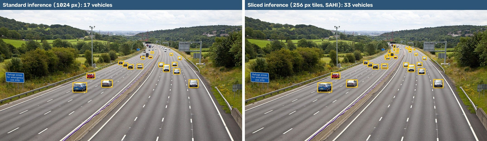
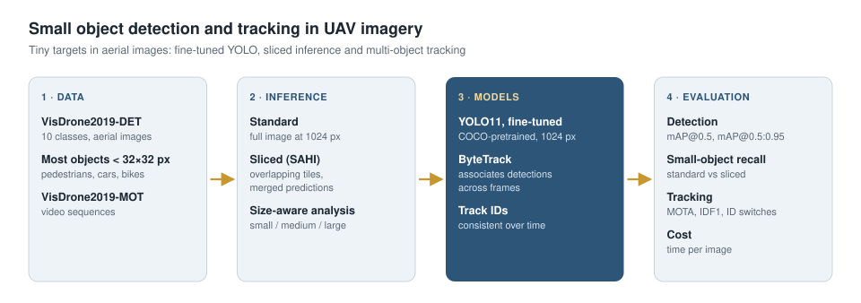

# Small Object Detection and Tracking in UAV Imagery

Detection of **small objects** such as vehicles and pedestrians in drone-captured aerial images, and **multi-object tracking** across video frames.

<p align="center"></p>
<p align="center"><sub>Same model, same image, same confidence threshold (0.25): COCO-pretrained YOLO11s before fine-tuning on VisDrone. Sliced inference recovers many of the distant vehicles that standard inference misses. Image: SAHI demo data.</sub></p>

## Problem

In UAV payload cameras, targets occupy only a tiny fraction of the image. Most objects in the VisDrone dataset are smaller than 32×32 pixels. Standard object detectors tend to miss objects at this scale and fail to keep consistent identities across video frames.

## Approach

<p align="center"></p>

| Step | Method | File |
|---|---|---|
| 1. Fine-tuning | Fine-tune a COCO-pretrained YOLO model on VisDrone-DET at high resolution (1024 px) | `src/train.py` |
| 2. Sliced inference | Process the image as overlapping tiles (SAHI) and compare against standard inference | `src/evaluate_small_objects.py` |
| 3. Size-aware analysis | Separate recall for small / medium / large objects | `src/evaluate_small_objects.py` |
| 4. Tracking | Associate detections across frames with ByteTrack | `src/track.py` |
| 5. Tracking evaluation | MOTA and IDF1 on VisDrone-MOT | `src/eval_mot.py` |

## Data

- **VisDrone2019-DET**: 10 classes (pedestrian, people, bicycle, car, van, truck, tricycle, awning-tricycle, bus, motor). Downloaded and converted to YOLO format automatically by the Ultralytics `VisDrone.yaml` on the first run.
- **VisDrone2019-MOT**: Video sequences for tracking evaluation ([official repository](https://github.com/VisDrone/VisDrone-Dataset)).

## Installation

```bash
git clone https://github.com/mahdildarr/uav-small-object-detection.git
cd uav-small-object-detection
pip install -r requirements.txt
```

The quickest way to run everything is the `notebooks/colab_training_and_evaluation.ipynb` notebook on Google Colab (GPU enabled).

## Usage

```bash
# 1) Training
python src/train.py --model yolo11s.pt --epochs 50 --imgsz 1024 --batch 8 --name yolo11s_1024

# 2) Standard vs. sliced inference, broken down by object size
python src/evaluate_small_objects.py --weights runs/visdrone/yolo11s_1024/weights/best.pt --limit 200 --save-vis 6

# 3) Tracking on video
python src/frames_to_video.py --frames <MOT sequence folder> --out sequence.mp4
python src/track.py --weights runs/visdrone/yolo11s_1024/weights/best.pt --source sequence.mp4

# 4) Tracking metrics
python src/eval_mot.py --weights runs/visdrone/yolo11s_1024/weights/best.pt \
    --seq-dir <MOT sequence folder> --gt <annotations/sequence.txt>
```

## Evaluation metrics

- **Detection:** mAP@0.5, mAP@0.5:0.95; recall for small / medium / large objects
- **Tracking:** MOTA, IDF1, ID switches (IDSW)
- **Speed:** Inference time per image (to quantify the cost of sliced inference)

## Roadmap

- [x] Training, evaluation and tracking pipeline
- [ ] Baseline training on VisDrone-DET
- [ ] Standard vs. sliced inference comparison
- [ ] Comparison of input resolution and augmentation strategies
- [ ] Tracking evaluation on VisDrone-MOT

## Project structure

```
├── notebooks/colab_training_and_evaluation.ipynb
├── src/
│   ├── train.py                   # VisDrone fine-tuning
│   ├── evaluate_small_objects.py  # standard vs. sliced inference, size-aware recall
│   ├── track.py                   # ByteTrack tracking
│   ├── eval_mot.py                # MOTA / IDF1
│   ├── frames_to_video.py         # frame folder -> video
│   └── utils.py                   # IoU, label parsing, matching
└── requirements.txt
```

## References

- Zhu et al., *Detection and Tracking Meet Drones Challenge*, IEEE TPAMI, 2021 (VisDrone)
- Akyon et al., *Slicing Aided Hyper Inference and Fine-tuning for Small Object Detection*, ICIP 2022 (SAHI)
- Zhang et al., *ByteTrack: Multi-Object Tracking by Associating Every Detection Box*, ECCV 2022
- [Ultralytics YOLO](https://github.com/ultralytics/ultralytics)

## License

MIT
