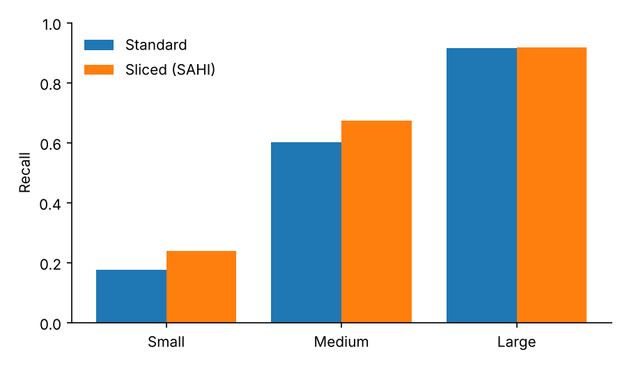
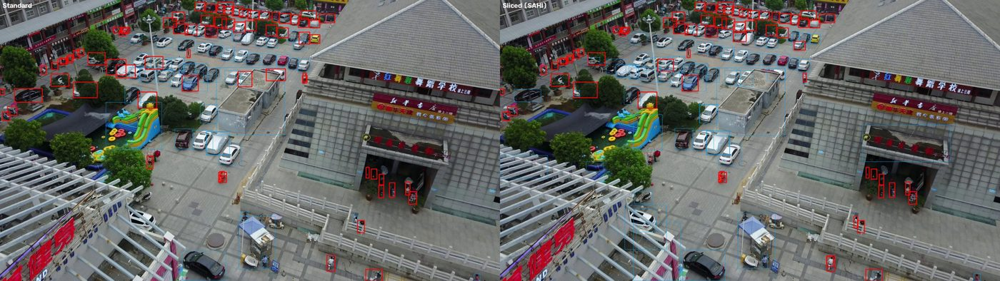

# Small Object Detection and Tracking in UAV Imagery

[](https://github.com/mahdildarr/uav-small-object-detection/actions/workflows/ci.yml)

Detection of **small objects** such as vehicles and pedestrians in drone-captured aerial images, and **multi-object tracking** across video frames.

<p align="center"></p>
<p align="center"><sub>Same model, same image, same confidence threshold (0.25): COCO-pretrained YOLO11s before fine-tuning on VisDrone. Sliced inference recovers many of the distant vehicles that standard inference misses. Image: SAHI demo data.</sub></p>

## Problem

In UAV payload cameras, targets occupy only a tiny fraction of the image. Most objects in the VisDrone dataset are smaller than 32×32 pixels. Standard object detectors tend to miss objects at this scale and fail to keep consistent identities across video frames.

## Approach

<p align="center"></p>

| Step | Method | Module |
|---|---|---|
| 1. Fine-tuning | Fine-tune a COCO-pretrained YOLO model on VisDrone-DET at high resolution (1024 px), from a YAML config | `uavdet.train` |
| 2. Slicing-aided fine-tuning | Optionally train on 640 px tiles cut from the full images, so that the training object scale matches sliced inference | `uavdet.slice_dataset` |
| 3. Sliced inference | Overlapping tiles (SAHI) plus a full-image pass, compared with standard inference on the same images | `uavdet.evaluate` |
| 4. Size-aware evaluation | Recall per COCO size bucket at a fixed operating point, COCO AP / AP_small / AP_medium / AP_large (pycocotools), and paired bootstrap 95% intervals for every difference | `uavdet.evaluate` |
| 5. Ignored regions | Raw VisDrone annotations are read so that detections in *ignored regions* are not counted as false positives (they become crowd boxes for COCOeval) | `uavdet.visdrone` |
| 6. Tracking | ByteTrack or BoT-SORT over whole VisDrone-MOT sequences; results written in MOT format | `uavdet.track` |
| 7. Tracking evaluation | MOTA, IDF1, ID switches, fragmentations, MT / ML with py-motmetrics, following the VisDrone-MOT protocol (five scored categories, ignored regions) | `uavdet.eval_mot` |

## Data

- **VisDrone2019-DET**: 10 classes (pedestrian, people, bicycle, car, van, truck, tricycle, awning-tricycle, bus, motor). Downloaded and converted to YOLO format automatically by the Ultralytics `VisDrone.yaml` on the first run.
- **VisDrone2019-MOT**: Video sequences for tracking evaluation ([official repository](https://github.com/VisDrone/VisDrone-Dataset)).

## Installation

```bash
git clone https://github.com/mahdildarr/uav-small-object-detection.git
cd uav-small-object-detection
pip install -e ".[dev]"
pytest -q          # unit tests + end-to-end runs on synthetic data (no GPU or weights needed)
```

The quickest way to run everything is the `notebooks/colab_training_and_evaluation.ipynb` notebook on Google Colab (GPU enabled).

## Usage

```bash
# 1) Training (any setting can be overridden: --set epochs=10 imgsz=640)
python -m uavdet.train --config configs/visdrone_yolo11s_1024.yaml

# 2) Standard vs sliced inference by object size, with COCO AP and bootstrap intervals
python -m uavdet.evaluate --weights runs/visdrone/yolo11s_1024/weights/best.pt \
    --images <VisDrone2019-DET-val>/images --annotations <VisDrone2019-DET-val>/annotations --limit 0 --ap --save-vis 6

# 3) Tracking on all VisDrone-MOT sequences, then scoring
python -m uavdet.track --weights runs/visdrone/yolo11s_1024/weights/best.pt \
    --sequences <VisDrone2019-MOT-val>/sequences --tracker bytetrack.yaml --out runs/track/bytetrack
python -m uavdet.eval_mot --results runs/track/bytetrack --annotations <VisDrone2019-MOT-val>/annotations

# Optional: slicing-aided fine-tuning
python -m uavdet.slice_dataset --data VisDrone.yaml --out datasets/VisDrone-sliced --slice 640 --overlap 0.2
python -m uavdet.train --config configs/visdrone_sliced_finetune.yaml
```

## Evaluation metrics

- **Detection:** COCO AP, AP50, AP75, AP_small / medium / large (up to 500 detections per image, since aerial images hold far more than COCO's default 100); recall per size bucket and precision at a fixed confidence threshold
- **Uncertainty:** paired bootstrap over images (objects in one image are correlated, so images are resampled, and both methods see the same resample)
- **Tracking:** MOTA, MOTP, IDF1, ID switches, fragmentations, mostly tracked / mostly lost
- **Speed:** inference time per image (to quantify the cost of sliced inference)

## Results

### Zero-shot baseline on VisDrone2019-DET val

Before any fine-tuning, a COCO-pretrained YOLO11s was evaluated on all 548 validation images, with standard inference at 1024 px and sliced inference (640 px tiles, 20% overlap, plus a full-image pass). Because COCO and VisDrone use different class lists, both are mapped to three shared groups (person, vehicle, two-wheeler); tricycles have no COCO counterpart and are left out. Detections inside VisDrone's ignored regions are not scored. At the operating point a detection counts if it overlaps a ground-truth box of the same group with IoU ≥ 0.5 (confidence ≥ 0.25).

| Method | Precision | Recall, small (<32²) | Recall, medium (32²–96²) | Recall, large (>96²) | AP50 | AP | AP_small | AP_large |
|---|---|---|---|---|---|---|---|---|
| Standard | 0.838 | 0.175 | 0.603 | 0.914 | 0.386 | 0.216 | 0.136 | 0.733 |
| Sliced (SAHI) | 0.719 | 0.239 | 0.674 | 0.918 | 0.412 | 0.218 | 0.143 | 0.663 |
| Difference (95% CI) | −0.119 [−0.126, −0.112] | +0.064 [+0.058, +0.070] | +0.071 [+0.064, +0.079] | +0.004 [−0.007, +0.015] | +0.026 | +0.002 | +0.007 | −0.070 |

Ground-truth objects: 25,650 small, 10,481 medium, 1,051 large. Intervals: paired bootstrap over images, 1,000 resamples.

<p align="center"></p>

Most objects in VisDrone are small, and this is where the pretrained model struggles most: it finds fewer than one in five of them. Slicing raises small-object recall from 0.175 to 0.239 (about 37% more objects found) and medium-object recall from 0.603 to 0.674; both gains are far outside their confidence intervals. The cost is lower precision and roughly four to five times the inference time (0.44 s vs 1.65 s per image on a CPU with inference at the operating-point threshold).

The COCO AP shows what the recall numbers hide. AP50 improves, but AP over IoU 0.5–0.95 barely moves (0.216 → 0.218): boxes found on tiles are found, but not localised more precisely, and large objects lose AP (0.733 → 0.663) because they are cut by tile borders and their fragments survive the merge as extra boxes. Slicing is therefore a recall tool for small objects rather than a free improvement, and even with slicing more than three quarters of the small objects are missed, which is the motivation for fine-tuning on VisDrone at high resolution.

<p align="center"></p>
<p align="center"><sub>Validation image, standard (left) vs sliced (right) inference. Thin boxes: predictions; red boxes: objects that were missed.</sub></p>

The numbers can be reproduced with:

```bash
wget https://github.com/ultralytics/assets/releases/download/v0.0.0/VisDrone2019-DET-val.zip && unzip VisDrone2019-DET-val.zip
python -m uavdet.evaluate --weights yolo11s.pt --images VisDrone2019-DET-val/images \
    --annotations VisDrone2019-DET-val/annotations --limit 0 --coco-zero-shot --ap --save-vis 6
```

With `--ap`, inference runs at confidence 0.01 so that AP sees the full precision-recall curve, and sliced predictions are merged with NMS (SAHI's recommendation at low thresholds); the operating-point numbers are obtained from the same predictions by filtering at 0.25.

## Progress

- [x] Fine-tuning script for VisDrone-DET at high resolution
- [x] Standard vs sliced (SAHI) inference with size-aware recall
- [x] Multi-object tracking with ByteTrack
- [x] MOTA / IDF1 evaluation on VisDrone-MOT sequences
- [x] Colab notebook for training and evaluation
- [x] First qualitative comparison of standard vs sliced inference
- [x] Zero-shot standard vs sliced comparison on the full VisDrone validation set
- [x] COCO AP by object size, ignored regions, paired bootstrap intervals
- [x] Slicing-aided fine-tuning data pipeline
- [x] Tracking evaluation with py-motmetrics following the VisDrone-MOT protocol
- [x] Package, unit tests, end-to-end tests on synthetic data, CI

Next:

- [ ] Baseline training on VisDrone-DET
- [ ] Standard vs sliced comparison after fine-tuning
- [ ] Tracking evaluation on VisDrone-MOT

## Project structure

```
├── configs/                       # training configs (full-image and sliced fine-tuning)
├── notebooks/colab_training_and_evaluation.ipynb
├── src/uavdet/
│   ├── train.py                   # fine-tuning from a YAML config
│   ├── slice_dataset.py           # tiled dataset for slicing-aided fine-tuning
│   ├── detectors.py               # standard and sliced (SAHI) inference behind one interface
│   ├── evaluate.py                # size-aware comparison, COCO AP, bootstrap intervals
│   ├── metrics.py                 # per-image records, bootstrap, COCOeval wrapper
│   ├── visdrone.py                # VisDrone formats, class groups, ignored regions
│   ├── boxes.py                   # IoU / IoA, label parsing, matching, size buckets
│   ├── track.py                   # ByteTrack / BoT-SORT, MOT-format output
│   ├── eval_mot.py                # MOTA / IDF1 with py-motmetrics
│   └── video.py                   # frame folder -> video
├── tests/
├── tools/make_synthetic_visdrone.py
└── pyproject.toml
```

## References

- Zhu et al., *Detection and Tracking Meet Drones Challenge*, IEEE TPAMI, 2021 (VisDrone)
- Akyon et al., *Slicing Aided Hyper Inference and Fine-tuning for Small Object Detection*, ICIP 2022 (SAHI)
- Zhang et al., *ByteTrack: Multi-Object Tracking by Associating Every Detection Box*, ECCV 2022
- Bernardin & Stiefelhagen, *Evaluating Multiple Object Tracking Performance: The CLEAR MOT Metrics*, 2008; Ristani et al., *Performance Measures and a Data Set for Multi-Target, Multi-Camera Tracking* (IDF1), 2016
- [Ultralytics YOLO](https://github.com/ultralytics/ultralytics)

## License

MIT
